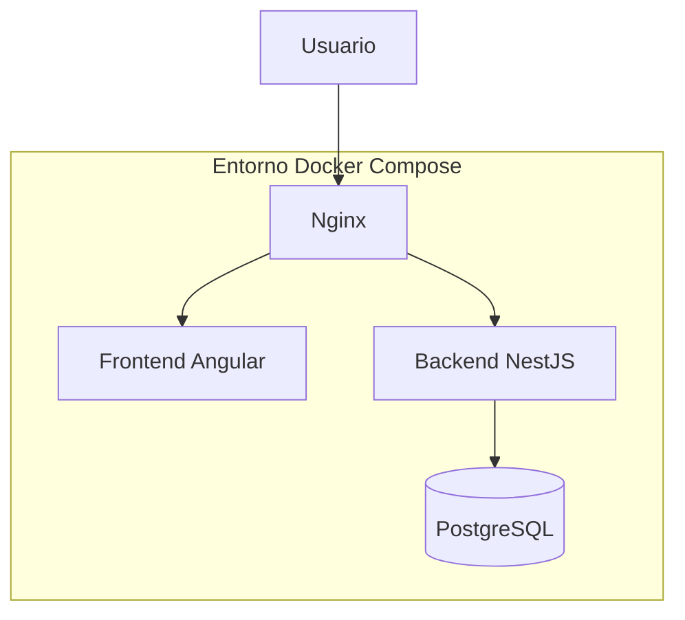
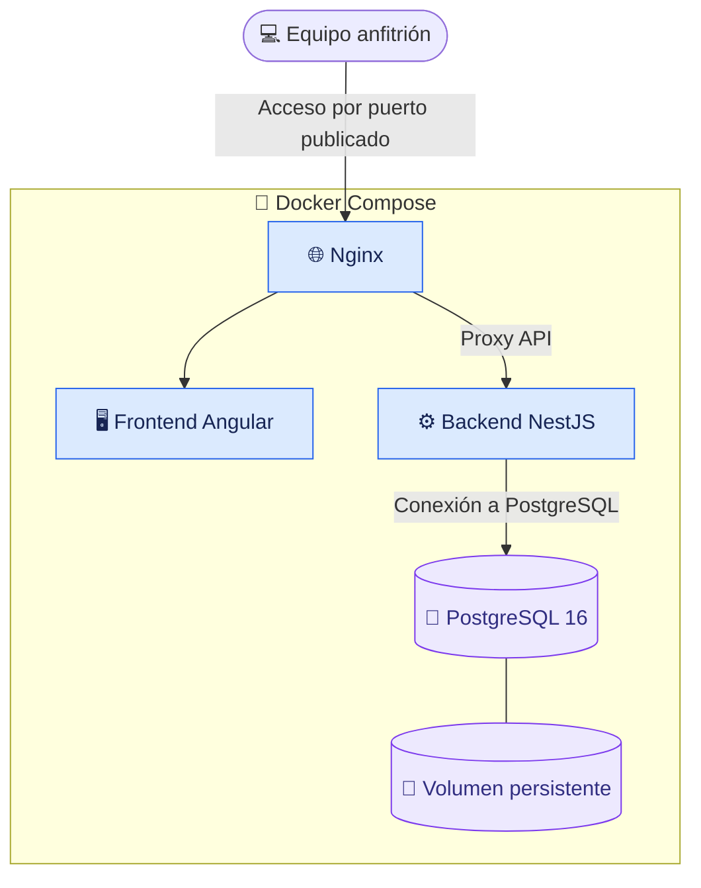
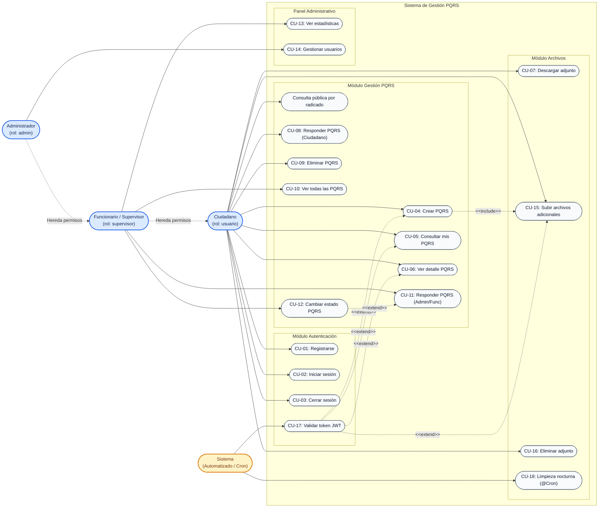
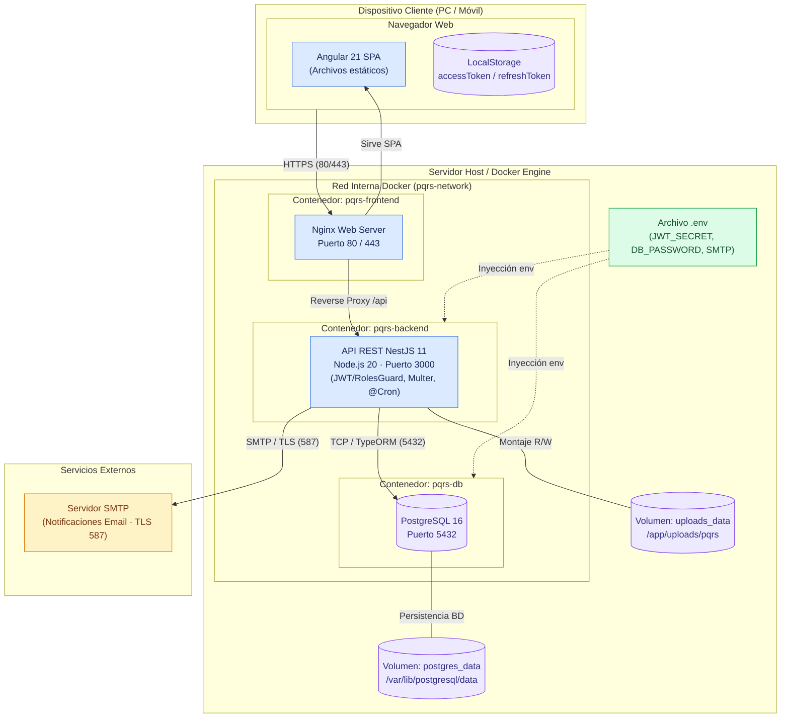
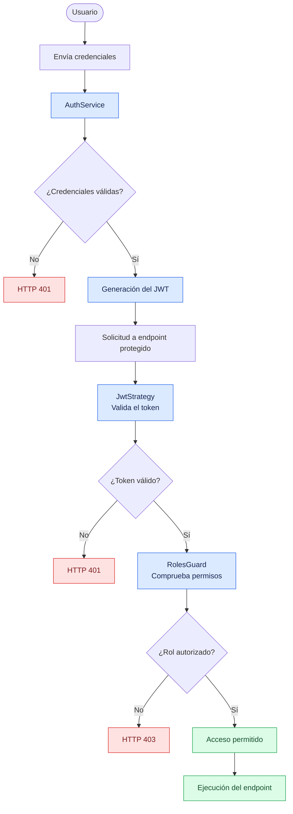
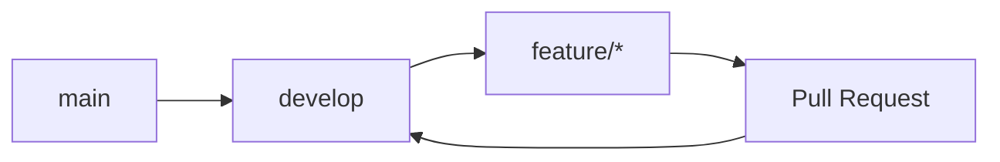

#  PQRS | Sistema de Peticiones, Quejas, Reclamos y Sugerencias

<p align="center">
  
  
  
  
  
</p>

<p align="center">
  <strong>Una plataforma para centralizar, gestionar y realizar seguimiento a las solicitudes de la comunidad universitaria.</strong>
</p>

---

##  Sobre el proyecto

**PQRS** es un sistema de información diseñado para gestionar las Peticiones, Quejas, Reclamos y Sugerencias de la comunidad universitaria.

La plataforma busca facilitar el registro de solicitudes, organizar su atención y permitir el seguimiento de cada caso mediante una estructura tecnológica modular.

###  Objetivos principales

-  Centralizar el registro de solicitudes.
-  Facilitar el seguimiento de los casos.
-  Proteger la información mediante mecanismos de autenticación y autorización.
-  Organizar los servicios de la aplicación en una arquitectura modular.
-  Preparar el entorno para futuras prácticas de integración y entrega continua (CI/CD).

---

##  Arquitectura tecnológica

El proyecto está organizado en tres componentes principales, apoyados por servicios de infraestructura y contenedorización.

| Componente | Tecnología | Responsabilidad |
|:---|:---|:---|
|  Frontend | Angular 21 | Interfaz de usuario |
|  Backend | NestJS 11 + TypeORM | API REST y lógica de negocio |
|  Base de datos | PostgreSQL 16 | Persistencia de información |
|  Contenedores | Docker Compose | Orquestación de servicios |
|  Servidor web | Nginx | Entrada web y enrutamiento |

###  Vista general de la arquitectura



> **Nota:** Docker Compose permite definir y administrar los servicios del entorno desde un archivo de configuración centralizado.

---

### 🐳 Infraestructura y comunicación de servicios


---
---

## Diagrama de Casos de Uso

Representación de los actores del sistema (`Ciudadano`, `Funcionario`, `Administrador` y `Sistema`) y su interacción con los 18 casos de uso agrupados por módulo.



---

## Diagrama de Despliegue (Docker & Infraestructura)

Distribución física y lógica de los nodos, contenedores Docker, volúmenes persistentes y servicios externos en producción.



##  Estructura del repositorio

```text
pqrs-devops/
│
├──  pqrs-backend/
│   ├── src/
│   ├── migrations/
│   ├── package.json
│   └── Dockerfile
│
├──  pqrs-frontend/
│   ├── src/
│   ├── package.json
│   └── Dockerfile
│
├──  scripts/
│   └── generate-env.ps1
│
├──  docs/
│
├──  docker-compose.yml
├──  docker-compose.dev.yml
├──  .env.example
├──  .gitignore
└──  README.md
```

---

##  Requisitos previos

Antes de ejecutar el proyecto, asegúrate de contar con las siguientes herramientas:

| Herramienta | Versión / requisito |
|:---|:---|
| Node.js | 20 o superior |
| npm | 9 o superior |
| Docker Desktop | Instalado y en ejecución |
| Git | Instalado |
| PowerShell | Para el script de generación de variables de entorno |

### 🔗 Herramientas oficiales

- [Node.js](https://nodejs.org/)
- [npm](https://www.npmjs.com/)
- [Docker Desktop](https://www.docker.com/products/docker-desktop/)
- [Git](https://git-scm.com/)

---

##  Puesta en marcha

### 1. Clonar el repositorio

```bash
git clone <URL_DEL_REPOSITORIO>
cd pqrs-devops
```

### 2. Configurar las variables de entorno

El proyecto utiliza variables de entorno para gestionar credenciales, secretos y parámetros de configuración.

En Windows PowerShell, desde la raíz del proyecto:

```powershell
.\scripts\generate-env.ps1
```

Este script genera el archivo `.env` a partir de `.env.example`, incluyendo secretos aleatorios para la configuración inicial.

>  **Importante:** el archivo `.env` contiene información sensible. No debe subirse al repositorio ni compartirse públicamente.

### 3. Construir y levantar los servicios

```bash
docker compose up -d --build
```

### 4. Verificar los contenedores

```bash
docker compose ps
```

Para consultar los registros:

```bash
docker compose logs -f
```

> Los puertos y las direcciones de acceso dependen de la configuración del archivo `.env` y de Docker Compose.

---

##  Comandos útiles

###  Docker Compose

| Comando | Descripción |
|:---|:---|
| `docker compose up -d` | Inicia los servicios en segundo plano |
| `docker compose up -d --build` | Construye e inicia los servicios |
| `docker compose down` | Detiene y elimina los contenedores |
| `docker compose ps` | Consulta el estado de los servicios |
| `docker compose logs -f` | Visualiza los registros en tiempo real |
| `docker compose restart` | Reinicia los servicios |

###  Dependencias

| Comando | Descripción |
|:---|:---|
| `npm install` | Instala las dependencias del proyecto |
| `npm run build` | Construye el backend |
| `npm audit --omit=dev` | Revisa vulnerabilidades en dependencias de producción |

---

##  Seguridad de la aplicación

La configuración del proyecto contempla diferentes medidas para proteger los servicios y la información.

| Medida | Descripción |
|:---|:---|
|  Variables de entorno | Gestión de credenciales y secretos fuera del código fuente |
|  JWT | Autenticación mediante tokens |
|  Control de acceso | Restricción de operaciones según roles y permisos |
|  TLS | Validación de certificados en conexiones SMTP |
|  Docker | Aislamiento y configuración de servicios |
|  Dependencias | Actualización y auditoría de paquetes |


###  Flujo de autenticación y autorización




### Buenas prácticas

- No publicar archivos `.env`.
- No incluir contraseñas ni secretos en el código fuente.
- Utilizar contraseñas y secretos robustos.
- Mantener actualizadas las dependencias.
- Revisar los permisos de acceso a los endpoints.
- Validar las configuraciones antes de desplegar.

---

##  Base de datos y migraciones

El backend utiliza **TypeORM** para gestionar la estructura y evolución de la base de datos PostgreSQL.

Las migraciones permiten registrar y aplicar cambios de estructura de manera controlada.

### Comandos principales

```bash
# Consultar migraciones
npm run typeorm -- migration:show -d src/db/data-source.ts

# Generar una migración
npm run migration:generate -- src/db/migrations/NombreDeLaMigracion

# Ejecutar migraciones
npm run migrate

# Revertir la última migración
npm run migrate:revert

# Cargar datos iniciales
npm run seed
```

> Ejecuta los comandos desde el directorio que corresponda a los scripts definidos en el `package.json` del backend o del proyecto raíz.

---

##  API REST

El backend está desarrollado con NestJS y expone servicios REST para la gestión de las solicitudes.

La documentación interactiva de Swagger permite consultar los endpoints, sus parámetros y las respuestas de la API.

**Documentación local:**

```text
http://localhost:3000/api
```

*La dirección depende del puerto configurado para el backend.*

---

##  Documentación adicional

| Documento | Descripción |
|:---|:---|
| `CASOS_DE_USO.md` | Casos de uso del sistema |
| `ESTADOS_FLUJO.md` | Flujo de estados de una PQRS |
| `PRIORIDAD.md` | Criterios de priorización |
| `SEGURIDAD.md` | Consideraciones de seguridad |
| `USUARIOS_SEED.md` | Información sobre usuarios de prueba |
| `pqrs-backend/FILE_UPLOAD_DOCUMENTATION.md` | Documentación de carga de archivos |

---

##  Solución de problemas

<details>
<summary><strong> Error de conexión con PostgreSQL</strong></summary>

Verifica que Docker esté en ejecución y que el contenedor de PostgreSQL esté activo:

```bash
docker compose ps
docker compose logs postgres
```

</details>

<details>
<summary><strong> Puerto ocupado</strong></summary>

Comprueba qué servicio está utilizando el puerto y revisa la configuración de puertos en Docker Compose y las variables de entorno.

</details>

<details>
<summary><strong> Error al ejecutar migraciones</strong></summary>

Verifica la conexión a la base de datos, las credenciales y que el servicio PostgreSQL esté disponible.

```bash
docker compose logs postgres
```

</details>

<details>
<summary><strong> Problemas con las dependencias</strong></summary>

Verifica que estés utilizando una versión compatible de Node.js y ejecuta la instalación de dependencias en el directorio correspondiente.

</details>

---

##  Desarrollo y colaboración

Este proyecto se desarrolla bajo un esquema de trabajo colaborativo utilizando Git y GitHub.

Se emplean ramas para organizar las funcionalidades, correcciones y tareas de desarrollo.

### Flujo de trabajo



Las contribuciones se integran mediante Pull Requests y revisión de cambios, siguiendo las reglas de colaboración definidas por el equipo.

---

<p align="center">
  <strong> PQRS — Tecnología para una gestión universitaria más organizada.</strong>
  <br>
  <sub>Proyecto académico · Desarrollo de Software</sub>
</p>
