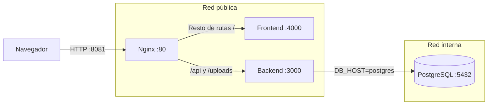

# Cómo está armada la aplicación en Docker

Este documento describe la arquitectura local del sistema PQRS: qué hace cada contenedor, cómo se comunican, qué puertos usan, dónde guardan datos y qué variables necesitan.

La definición principal está en [`docker-compose.yml`](./docker-compose.yml), las reglas de entrada en [`nginx/default.conf`](./nginx/default.conf), y los Dockerfiles de cada aplicación en [`pqrs-backend/Dockerfile`](./pqrs-backend/Dockerfile) y [`pqrs-frontend/Dockerfile`](./pqrs-frontend/Dockerfile).

## Vista rápida


En la máquina anfitriona solo se publica Nginx. Los puertos del frontend, backend y PostgreSQL son internos de Docker; otros contenedores pueden alcanzarlos por nombre de servicio.

## Servicios

| Servicio | Contenedor | Imagen o construcción | Puerto dentro de Docker | Puerto publicado en el host | Memoria máxima | Redes | Almacenamiento |
|---|---|---|---:|---:|---:|---|---|
| `nginx` | `pqrs_nginx` | `nginx:1.27-alpine` | `80` | `NGINX_PORT` `8081` → `80` | `64 MiB` | `publica` | Configuración Nginx montada como solo lectura |
| `frontend` | `pqrs_frontend` | Construido desde `pqrs-frontend/Dockerfile` | `4000` | No se publica | `256 MiB` | `publica` | Ninguno |
| `backend` | `pqrs_backend` | Construido desde `pqrs-backend/Dockerfile` | `3000` | No se publica | `512 MiB` | `publica`, `interna` | Archivos subidos montados desde el host |
| `postgres` | `pqrs_postgres` | `postgres:16-alpine` | `5432` | No se publica | `256 MiB` | `interna` | Volumen Docker `postgres_data` |

Los topes suman **1.088 MiB** (aproximadamente **1,06 GiB**) para los cuatro contenedores en ejecución. Son límites de ejecución: no limitan la memoria que Docker Desktop consume al construir las imágenes.

## Redes y comunicación

### `publica`

Es una red bridge de Docker. La comparten Nginx, el frontend y el backend.

- Nginx llega al frontend usando `frontend:4000`.
- Nginx llega al backend usando `backend:3000`.
- El backend también está en esta red para atender las solicitudes que le reenvía Nginx.
- El nombre de la red no significa que todos los contenedores queden expuestos a Internet. La única publicación al host es el puerto de Nginx.

### `interna`

Es una red bridge marcada como `internal: true`. Solo conecta el backend con PostgreSQL.

- El backend usa `DB_HOST=postgres` y `DB_PORT=5432`.
- PostgreSQL no tiene un puerto publicado al host ni pertenece a `publica`.
- La aplicación y los clientes de tu máquina no deberían conectarse directamente a la base de datos con esta configuración.

## Puertos y direcciones

La entrada desde el navegador es:

```text
http://localhost:8081
```

El valor de `8081` viene de `NGINX_PORT` en el `.env` de la raíz. Si no está definido, Compose usa `8080`. Puedes elegir otro puerto libre si ya está ocupado por Jenkins u otro proceso.

Desde el navegador, las rutas quedan así:

| Ruta | La recibe | La reenvía a |
|---|---|---|
| `/api/` | Nginx | `backend:3000` |
| `/uploads/` | Nginx | `backend:3000` |
| Cualquier otra ruta, incluida `/` | Nginx | `frontend:4000` |

El frontend usa la URL relativa `/api`, así que el navegador conserva el mismo origen y Nginx distribuye la solicitud. Swagger queda en `http://localhost:8081/api/docs`.

Los puertos `4000`, `3000` y `5432` son puertos internos del Compose. No abras `localhost:4000`, `localhost:3000` ni `localhost:5432` esperando acceder a esos servicios desde el host: el Compose no los publica.

Nginx escucha en HTTP. Esta configuración no incluye TLS/HTTPS; para un servidor público habría que terminar TLS en Nginx o delante de él y publicar normalmente los puertos `80` y `443`.

## Persistencia y volúmenes

### Base de datos: `postgres_data`

PostgreSQL guarda sus datos en el volumen con nombre `postgres_data`, montado en `/var/lib/postgresql/data` dentro del contenedor. El volumen sobrevive a la recreación o eliminación del contenedor.

- `docker compose down` detiene y elimina contenedores y redes, pero conserva `postgres_data`.
- `docker compose down -v` también elimina el volumen y, por tanto, borra la base de datos local. Úsalo solo si quieres reiniciar los datos desde cero.

### Archivos cargados: `pqrs-backend/uploads`

La carpeta local `./pqrs-backend/uploads` se monta en `/app/uploads` dentro del backend. Los archivos cargados quedan en el proyecto local, y se conservan aunque se reemplace el contenedor backend.

### Configuración de Nginx

`./nginx/default.conf` se monta en `/etc/nginx/conf.d/default.conf` como solo lectura (`:ro`). No se copia ni modifica dentro de la imagen al iniciar.

## Qué hace cada contenedor

### Nginx

Es la puerta de entrada. Publica `NGINX_PORT` en el host y recibe las solicitudes en el puerto 80 del contenedor. Según la ruta, envía la solicitud al backend o al frontend. Acepta cargas de hasta `50m` mediante `client_max_body_size`.

### Frontend

Angular se construye dentro de una etapa de Node.js 22 Alpine. La imagen final ejecuta el servidor SSR de Angular en el puerto `4000`. Nginx lo encuentra por el nombre de servicio `frontend`.

### Backend

NestJS se construye con Node.js 22 Alpine y escucha en el puerto `3000`. Al iniciar, primero ejecuta las migraciones TypeORM pendientes y después arranca la API. Para eso necesita que PostgreSQL esté saludable.

### PostgreSQL

Usa PostgreSQL 16 Alpine. Compose comprueba su disponibilidad con `pg_isready`; el backend espera esa comprobación antes de arrancar. La base de datos solo está conectada a la red `interna`.

## Variables de entorno

Compose lee las variables del archivo `.env` ubicado junto a `docker-compose.yml`. El archivo `.env` no debe subirse a Git; la plantilla es [`.env.example`](./.env.example).

| Variable | Uso |
|---|---|
| `DB_USER`, `DB_PASSWORD`, `DB_NAME` | Credenciales y nombre de la base. Compose las pasa a PostgreSQL y al backend. |
| `DB_HOST`, `DB_PORT` | En el backend de Compose se fijan internamente a `postgres` y `5432`, porque esa es la dirección dentro de la red Docker. |
| `NGINX_PORT` | Puerto del host donde se publica Nginx. En este entorno se usa `8081`; |
| `NODE_ENV` | Entorno del backend. |
| `JWT_SECRET`, `JWT_REFRESH_SECRET` | Secretos usados para firmar tokens. Compose requiere que estén definidos. Usa valores propios y seguros fuera del desarrollo local. |
| `FRONTEND_URL` | Origen permitido por la configuración CORS del backend. En local debe coincidir con el origen desde el que abres la aplicación, por ejemplo `http://localhost:8081`. |
| `SMTP_SERVER`, `SMTP_PORT`, `EMAIL_USER`, `EMAIL_PASS` | Parámetros de correo que recibe el backend. Deben configurarse con las credenciales del servicio de correo que quieras usar. |

Aunque el navegador usa el mismo origen para la aplicación y `/api`, el backend conserva su configuración CORS y recibe `FRONTEND_URL`. Si cambias el puerto de Nginx, actualiza ese origen también y recrea el backend para que tome el cambio.

## Arranque y operaciones comunes

Desde la raíz del proyecto:

```powershell
docker compose up --build
```

Para dejarlo en segundo plano:

```powershell
docker compose up --build -d
```

Comandos útiles:

```powershell
docker compose ps
docker compose logs -f nginx frontend backend postgres
docker compose down
```

Las migraciones pendientes se ejecutan automáticamente al iniciar el backend. Para lanzarlas manualmente mientras está en ejecución:

```powershell
docker compose exec backend npm run migration:run
```

## Reinicio, cambios y cuidado de datos

- Si cambias `NGINX_PORT`, `FRONTEND_URL` u otra variable de entorno, recrea los servicios para que lean los valores nuevos:

  ```powershell
  docker compose up -d --force-recreate
  ```

- Si modificas un Dockerfile, una dependencia o el código que se copia durante el build, reconstruye con `docker compose up --build`.
